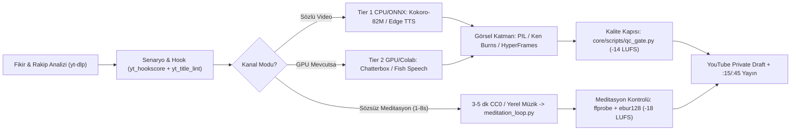

# ARCHITECTURE.md — `sis` Sistem Mimarisi

## 1. Genel Bakış ve Üç Depo Sınırı

- **Tek Teknik Sahip (Buğra):** `waldseelen/CONTENTY` (saf ortak çekirdek motor), `waldseelen/SACMA` (Buğra'nın kişisel kanal deposu) ve `waldseelen/sis` (bu depo — ablanın 12 kanallık üretim stüdyosu) birbirinden izole yaşar.
- `sis`, ortak çekirdek video kurgu, ses temizliği, thumbnail ve YouTube yükleme motorunu `waldseelen/CONTENTY` reposundan `core/` Git alt modülü (submodule) olarak tüketir; ablanın teknik bilgi gerektirmeyen tam otonom yapım asistanı kuralları, oyun kitapları ve 12 kanal profili ise yalnızca `sis` içinde yaşar.

```text
sis/
├── AGENT.md / AGENTS.md        # CLAUDE.md işaretçileri (OpenCode / Antigravity)
├── CLAUDE.md                   # Bağlayıcı yapımcı asistanı + güvenlik + kanal kuralları
├── BASLA.md                    # Sıfır teknik terimli içerik üreticisi başlangıç kartı
├── .agents/rules/
│   └── sis-producer.md         # Antigravity otomatik yapımcı-modu kuralı
├── ARCHITECTURE.md / SPEC.md / MEMORY.md / PROGRESS.md / README.md
├── core/                       # git submodule -> waldseelen/CONTENTY (ortak motor)
│   ├── skills/                 # studio-router, youtube-growth, faceless-and-shorts, ...
│   ├── scripts/                # qc_gate.py, yt_hookscore.py, yt_title_lint.py, ...
│   ├── plugins/contenty-studio/# eklenti manifesti ve şablonları
│   └── templates/              # edit.json, kurgu-atolyesi, video-motoru
├── playbooks/                  # Strateji, rakip analizi ve ücretsiz araç yığını
│   ├── growth-and-packaging.md
│   ├── competitor-remake.md
│   └── tts-and-music-stack.md
├── scripts/                    # sis'e özel kurulum, sync, durum ve meditasyon döngü araçları
│   ├── setup.sh / setup.ps1
│   ├── sync_core.sh / sync_core.ps1
│   ├── studio_status.py
│   └── meditation_loop.py
├── channels/                   # 12 kanal profili ve izole bölüm klasörleri
│   ├── 01-ehliyet-pass-test/
│   ├── ...
│   └── 12-sesli-kitap/
└── .github/workflows/
    └── sync-core.yml           # core/ submodule güncelleme otomasyonu
```

---

## 2. Çekirdek Senkronizasyonu ve Ayrı Laptop Akışı

1. **Geliştirici Laptopu (`CONTENTY`):** Ortak skill, hook, script veya mimari değişikliği `waldseelen/CONTENTY` `main` dalına push edilir.
2. **Alt Modül Köprüsü (`sis/core`):**
   - Yerelde `scripts/sync_core.sh` / `scripts/sync_core.ps1` çalıştırılarak `core/` en son `CONTENTY` commit'ine çekilir.
   - GitHub tarafında `.github/workflows/sync-core.yml` manuel (`workflow_dispatch`) veya zamanlanmış tetiklemeyle `core/` alt modülünü güncelleyen commit/PR açabilir.
3. **Üretim Laptopu (Windows 11 — ASUS Vivobook):**
   - Tek seferde `git clone --recurse-submodules https://github.com/waldseelen/sis.git` ile indirilir.
   - Güncellemek için `git pull && git submodule update --init --recursive` çalıştırılır.

---

## 3. İki Katmanlı Donanım Yönlendirmesi (İnce Kasa NPU'lu Laptop)

Üretim ortamı öncelikle Windows 11 ince kasa NPU'lu bir ASUS Vivobook olarak hedeflendiğinden, tüm boru hattı **düşük VRAM / GPU'suz çalışabilme** ilkesine göre iki katmanlıdır:



---

## 4. Çoklu Ajan Desteği (`setup.ps1` / `setup.sh`)

`sis` üç ajan ortamını destekler:
- **OpenCode / Codex / Antigravity:** Kök `AGENTS.md` -> `CLAUDE.md` zincirini doğrudan okur.
- **Claude Code:** Kök `CLAUDE.md` dosyasını okur; `setup.ps1` / `setup.sh` aracılığıyla `core/skills/*` dizinlerini `~/.claude/skills/` altına bağlar.
- **Antigravity:** `setup.ps1` / `setup.sh` ile `core/plugins/contenty-studio` yapısını `~/.gemini/config/plugins/contenty-studio` altına bağlar (Windows'ta yönetici symlink izni gerektirmemek için junction veya dosya kopyası fallback'i kullanır).
